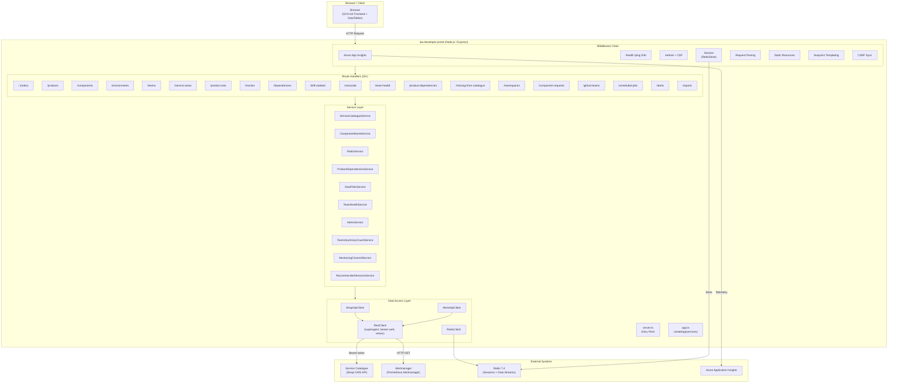
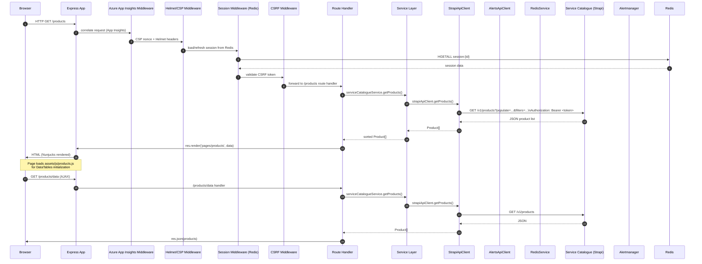
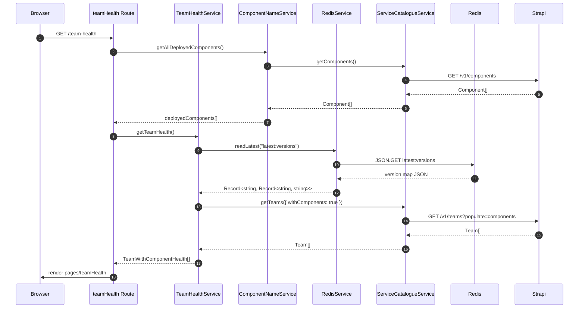
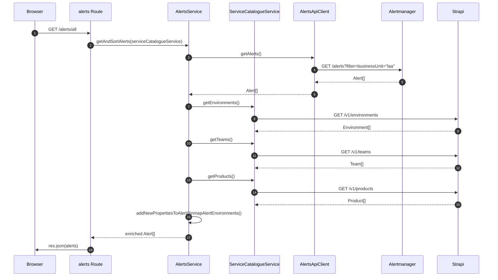
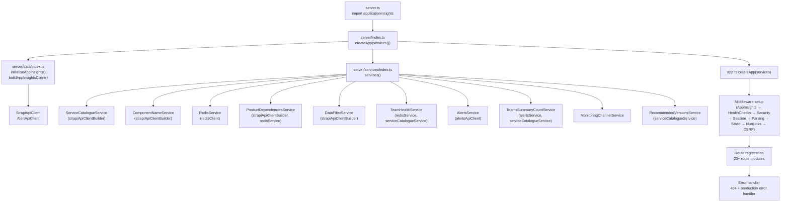
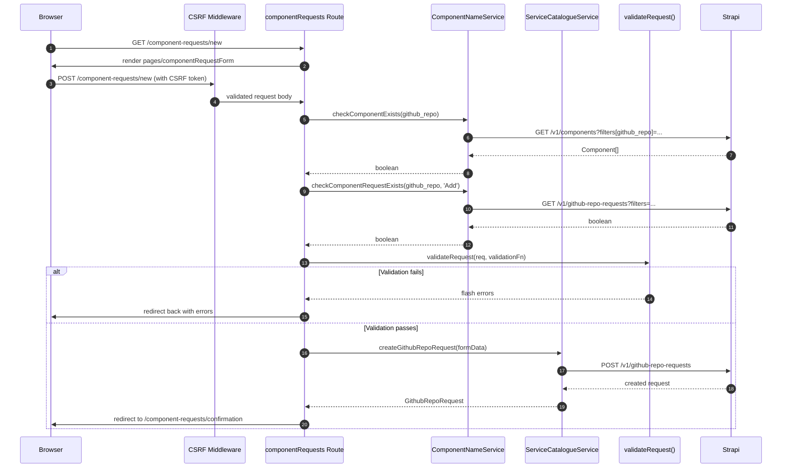
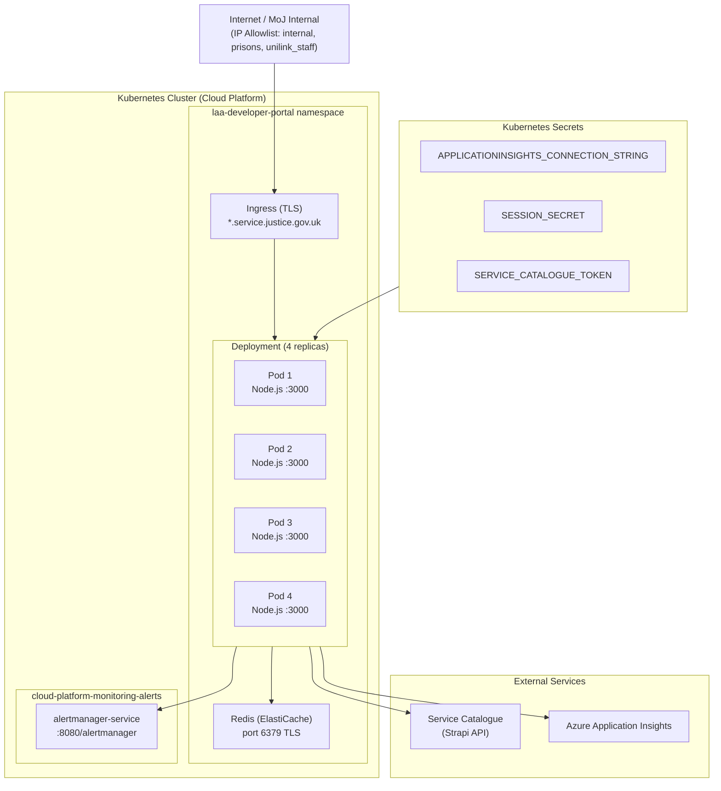

# LAA Developer Portal – Architecture Diagrams

## 1. High-Level System Architecture

---

## 2. Request Flow – Sequence Diagram

---

## 3. Team Health & Drift Radiator Data Flow

---

## 4. Alerts Flow

---

## 5. Application Startup & Dependency Wiring

---

## 6. Component Request Form Flow (POST with Validation)

---

## 7. Kubernetes Deployment Architecture

